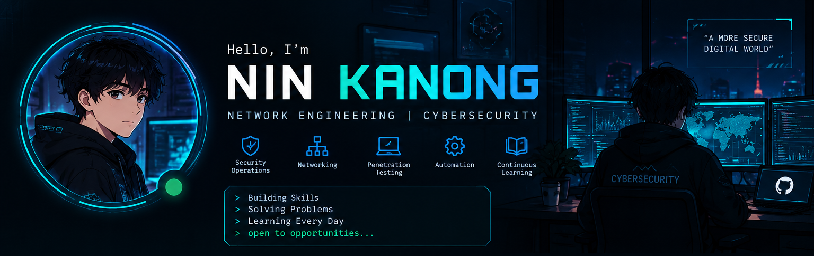

## Profile

  

I’m **Nin Kanong**, a Network Engineering and Security student interested in cybersecurity, networking, and practical security labs.

## About Me

- **Focus:** Network Engineering, Cybersecurity, and Security Operations (SOC)
- **Learning:** Network defense, threat detection, Linux, and security tools
- **Building:** Hands-on labs, technical notes, and open-source security projects
- **GitHub goal:** Document my progress, share useful write-ups, and keep improving

I believe in learning by doing: practice consistently, document what I learn, and turn knowledge into useful projects.

